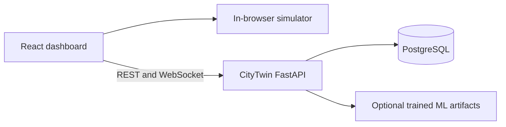

# CityTwin Web

The React dashboard for CityTwin, an interactive digital twin of a smart
district. Explore a 3D city, adjust energy and mobility assumptions, and
compare district KPIs. The browser-based simulator works on its own; connecting
the FastAPI service enables saved scenarios, sensor data, ML predictions, and
the live simulation stream.


## Features

- Interactive 3D district with buildings, roads, and traffic.
- What-if controls and presets for solar adoption, EV share, HVAC setpoint,
  traffic-signal efficiency, outdoor temperature, and activity level.
- District energy, comfort, congestion, and emissions KPIs.
- Optional FastAPI integration for server simulation and saved scenarios.
- Live WebSocket simulation, sensor-reading ingestion, and ML panels when the
  backend is configured.

## Requirements

- Node.js 20.19+ or 22.12+ (required by the Vite version in this project).
- npm.
- The [CityTwin server](../city-twin-server/README.md) is optional for local
  simulation, but required for backend-powered features.

## Run locally

From this directory:

```sh
npm install
npm run dev
```

Open the URL printed by Vite (normally `http://localhost:5173`). You can use
the dashboard's local simulator without starting the backend.

### Connect to the backend

Create a `.env` file in this directory if you need to override the API
endpoint or enable the live WebSocket stream:

```dotenv
VITE_API_URL=http://localhost:8000
VITE_WS_URL=ws://localhost:8000
```

The API URL defaults to `http://localhost:8000`. Set the WebSocket URL to the
same server origin using `ws://` for local development or `wss://` over HTTPS.
Start the backend separately, then enable **Use FastAPI backend** in the
dashboard. The live stream can be toggled in the Live panel.

## Commands

```sh
npm run dev       # Start the Vite development server
npm run build     # Type-check and create a production build in dist/
npm run preview   # Serve the production build locally
npm run lint      # Run ESLint
```

## Project layout

```text
src/
  components/     3D city elements and dashboard panels
  pages/          Dashboard composition
  store/          Redux state and RTK Query API client
  utils/          District data and local simulation
  assets/         Images and other bundled assets
public/           Static files served as-is
```

## How it fits together



For backend setup, API endpoints, database configuration, and model training,
see the [server README](../city-twin-server/README.md).
